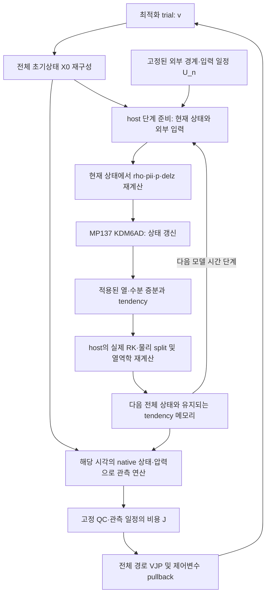

# MP137 자료동화 루프의 tendency–forcing 결합 설계

이 설계의 대상은 **최적화의 각 trial에서 full forward model을 다시 실행하는 자료동화**다.
별도로 한 번 실행한 예보장이나 고정된 `Sequence[Forcing]`을 모든 trial에 재사용하지 않는다.
물리 tendency로 갱신된 host 상태가 이후의 역학과 forcing에 영향을 주는 경로를 모델 연산자에 포함한다.

구현된 공통 인터페이스는 [`da_host_window.py`](../oracle/kdm6/da_host_window.py)다.
이 모듈은 결합 창의 전진/체크포인트/수반/JVP 실행 순서를 제공한다.
**실제 WRF 실행파일을 이 인터페이스에 연결하는 backend와 full-host 미분 backend는 아직 구현되지 않았다.**
현재 native MP137의 forward 실행 증거와 아래 인터페이스의 합성모델 테스트는 서로 다른 증거다.
기존 [`da_window.py`](../oracle/kdm6/da_window.py)와 중단된 KO 분석 snapshot은 기존 계약을 유지한다.

실제 MP137의 재시작 초기화와 짧은 창 재현에 대한 후속 증거는
[`NATIVE_MP137_REPLAY.md`](NATIVE_MP137_REPLAY.md)에 기록한다.
해당 value-only 검증과 full-host 미분 backend의 완성 여부는 별도로 판단한다.

## 1. 두 종류의 반복

최적화 trial을 `k`, 모델 시간 단계를 `n`으로 구분한다.

\[
 X_0^{(k)}=C(X_b,v^{(k)}),\qquad
 X_{n+1}^{(k)}=\Phi_{137,n}(X_n^{(k)},U_n;\Delta t).
\]

`C`는 제어변수를 **일관된 전체 host 초기상태**로 변환한다. T/Q만 바꾸고 나머지 진단장이
불일치한 상태를 넘기는 대신, 선택한 host 초기화/균형/상태 포장 계약을 따른다.
각 line-search trial도 동일한 배경시각의 `X_0`에서 시작한다. 이전 trial의 예보 끝 상태에서 이어가지 않는다.

`U_n`은 미리 정해진 경계조건과 외부 입력이다. 내부 상태가 바뀌어서 달라지는
압력·밀도·Exner·층 두께는 이 외부 입력에 넣지 않는다.



이 그림은 의존 관계를 나타낸다. RK와 미세물리의 시간 분할 순서는 기존 host 구현을 따른다.
특히 저장된 `H_DIABATIC`이 이후 RK에서 사용되고 small-step 보정에도 들어가는 것을
임의로 같은 단계에 두 번 적용하는 새 Euler 적분으로 대체하지 않는다.

## 2. tendency가 forcing에 영향을 주는 방법

가열량 `K/s`를 압력 `Pa`에 직접 더하는 방식이 아니다.

1. MP137이 TH/Q/수상체 및 수농도 상태를 갱신한다.
2. `moist_physics_finish_em`이 적용된 변화량과 시간 간격으로 tendency를 계산하고 host 온위를 갱신한다.
3. host의 RK·역학·압력/밀도/지오포텐셜 계산이 갱신된 상태와 필요한 tendency 메모리를 소비한다.
4. 다음 물리 준비 단계가 그 상태에서 KDM 입력을 새로 계산한다.

활성 소스의 해당 식은 다음과 같다.

\[
 \rho=1/(AL+ALB),\quad p=P+PB,\quad
 \pi=(p/p_0)^{R_d/C_p},\quad
 \Delta z_k=((PH+PHB)_{k+1}-(PH+PHB)_k)/g.
\]

실행 순서와 배열 포장은 다음 활성 private host 소스가 기준이다. public clone에는 없을 수 있다.

| 단계 | 활성 소스 |
|---|---|
| 현재 상태에서 밀도/압력/Exner 준비 | `host/KIM-meso_v1.0/dyn_em/module_big_step_utilities_em.F:5542`, `:5543`, `:5545` |
| 지오포텐셜에서 높이와 층 두께 준비 | `host/KIM-meso_v1.0/dyn_em/module_big_step_utilities_em.F:5480`, `:5488` |
| MP137 dispatch와 실제 상태 배열 전달 | `host/KIM-meso_v1.0/phys/module_microphysics_driver.F:2810` |
| C ABI 호출과 반환 TH/Q/QC를 host에 직접 기록 | `host/KIM-meso_v1.0/phys/module_mp_kdm6ad.F:287`, `:330`, `:331`, `:332` |
| 적용 전후 변화량과 theta_m·열·수분 tendency | `host/KIM-meso_v1.0/dyn_em/module_big_step_utilities_em.F:5688`, `:5693`, `:5736`, `:5740`, `:5763` |
| H_DIABATIC의 RK 소비와 small-step 보정 | `host/KIM-meso_v1.0/dyn_em/module_em.F:1078`, `:1079`, `module_small_step_em.F:421` |
| 갱신된 moist 상태에서 압력/밀도/지오포텐셜 재계산 | `host/KIM-meso_v1.0/dyn_em/solve_em.F:4192` |

기준 설정은 `MP_PHYSICS=137`, `NO_MP_HEATING=0`, `USE_THETA_M=1`, `USE_Q_DIABATIC=0`이다.
QV/QC는 이미 직접 갱신된다. `USE_Q_DIABATIC=1`은 별도의 RK 수분 tendency 가산 및 후속 감산 보정 경로다.
단순히 이 옵션을 켜는 것을 tendency 연결로 간주하지 않는다. 변경 시에는 별도 variant로 예산과 replay를 검증한다.

## 3. 전체 상태와 체크포인트

KDM의 12개 `State` 필드만 저장해서는 full forward를 replay할 수 없다.
backend는 완전한 timestep 경계를 선택하고 다음을 포함한 재현 가능한 상태를 선언한다.

- THM/온위, 모든 필요한 moist/scalar 필드와 미세물리 수·체적 관례.
- U/V/W, MU, PH 및 해당 host의 예보·기준 상태, 토양/지표 등 필요한 물리 메모리.
- 다음 단계에 유지되는 `H_DIABATIC`과 필요한 Q tendency, 물리 cache.
- timestep 내부를 경계로 택한다면 RK stage, 저장된 상태와 누적 tendency도 포함.
- 절대 시각·단계와 초기 CCN 처리 등 분기 재현에 필요한 고정 실행 문맥.

`required_state_fields`는 backend가 선언하는 필수 tensor 집합이다. 누락 시 공통 드라이버가 거부한다.
이 선언만으로 실제 host checkpoint 완전성이 인증되는 것은 아니다. native restart/replay 검증이 필요하다.
불연속 분기·정수 시간 인덱스·설정 등 미분하지 않는 문맥은 backend의 고정 사양과 단계 인덱스에 둔다.
상태 의존적인 실수 메모리를 고정 설정이나 외부 입력으로 숨기지 않는다.

## 4. 결합 창 인터페이스

| 인터페이스 | 책임 |
|---|---|
| `HostTransition.forward(n, X, U, dt)` | 현재 X에서 forcing을 다시 준비하고 실제 host 전체 한 단계를 수행 |
| `HostTransition.vjp(n, X_checkpoint, U, dt, lambda_next)` | 전체 단계를 로컬 replay하고 forcing 의존성을 포함한 full-state 수반 반환 |
| `HostTransition.jvp(n, X_checkpoint, U, dt, dX)` | 동일한 전체 단계의 방향 미분 반환 |
| `HostObservation` | 해당 시각의 비용, full-state 관측 수반, 고정 유효 개수와 support 서명 |
| `CoupledHostWindow.evaluate(X0)` | 매 trial 전 시간 창 재적분, 체크포인트, 관측 비용 누적 및 역순 VJP |
| `CoupledHostWindow.jvp(X0, dX0)` | 각 단계 full-model JVP로 최종 tangent 계산 |

공통 드라이버는 외부 입력 일정을 생성 시점에 복사하고, 이를 제어변수로 받지 않는다.
각 forward와 replay에는 독립된 checkpoint/외부 입력 값을 넘긴다.
`detach/clone`은 명시적인 timestep 체크포인트 경계에만 사용한다.
backend의 로컬 VJP/JVP 내부에서는 **새 live 상태에서 forcing을 다시 계산**해야 한다.

공통 창의 비용은 `J_obs`이고 반환 수반은 `dJ_obs/dX0`이다. 최적화 closure는

\[
 J(v)=J_b(v)+J_{obs}(C(X_b,v)),\quad
 \nabla_vJ=\nabla_vJ_b+C_v^T\,\lambda_0
\]

를 사용한다. 따라서 기존 minimizer에 새 `Forcing` 배열만 넣는 방식으로 연결하지 않는다.
별도의 full-host control encoder/pullback과 이 창 실행기를 연결해야 한다.
native encoder, full-host 미분 backend와 실제 최적화 연결은 아직 구현하지 않았다.
별도의 값 전용 `HostForwardWindow`와 origin-bound native prefix replay는
[`NATIVE_MP137_TRANSITION.md`](NATIVE_MP137_TRANSITION.md)에 기술했다.
이 경로는 중간 restart의 연속성 문제를 해결했다는 주장이 아니며,
아래 full-host 미분·최적화 계약에 해당하지 않는다.

실제 최적화 연결점은 다음 closure다. `encoder`와 `prior`는 검증된 값/수반 쌍을 제공해야 한다.
이는 연결 위치를 명시한 의사코드이며, 현재 native 실행에 연결된 예제가 아니다.

```python
def closure():
    optimizer.zero_grad()
    initial_host = encoder.forward_value(background, control)
    result = window.evaluate(initial_host, need_gradient=True)
    jb, grad_jb = prior.value_and_gradient(control)
    control.grad = grad_jb + encoder.vjp(control, result.adjoint_initial)
    return control.new_tensor(jb + result.cost)
```

호출 횟수는 optimizer iteration보다 많을 수 있다. line search의 모든 closure도
새 초기상태에서 모델 창 전체를 실행한다. 외부 입력/QC를 고정하는 것과 내부 forcing을 고정하는 것은 다르다.

Native 실행파일 adapter는 trial당 하나의 연속 host 적분 또는 검증된 장기 유지 stepper를 사용한다.
20초마다 실행파일을 새로 시작해 이어 붙이는 방식은 초기 CCN·방사·시간 분기와 tendency 메모리를
바꿀 수 있으므로, 동등한 full forward로 간주하지 않는다. 현재 per-step 인터페이스를 native에 연결하려면
완전한 restart/replay 동등성을 증명하거나 host의 실제 stepper를 노출해야 한다.

## 5. forcing과 관측 압력의 미분

한 단계의 의존 관계를 도식적으로

\[
 X^+=D(X,K(P(X),G(X,U)),U)
\]

라고 쓰면,

\[
 \Phi_X = D_X + D_K\left(K_zP_X + K_FG_X\right)
\]

가 필요하다. RK stage나 tendency 메모리가 있으면 이 연쇄를 실제 stage 순서대로 적용한다.
`K_F G_X`를 빠뜨린 고정 forcing 미분은 full coupled gradient가 아니다.
기존 KDM `Handle.vjp`도 forcing을 **같은 live state leaves**에서 만들면 그 간접 경로를 포함할 수 있다.
현재 legacy 창은 forcing을 미리 분리하므로 그 경로를 만들지 않는다.

관측은 `H(profile(X))`이다. T/Q/수상체뿐 아니라 모델 중심·경계 압력,
밀도 단위 변환, 수직 좌표와 이동하는 보간 가중치의 연쇄도 필요하다.
현재 `rttov_obs_operator.RttovObsOp`는 `p_lay/p_half`를 상수로 취급하고,
`model_profile_builder.interp_log_pressure`도 압력 보간 가중치를 고정한다.
파일/NumPy 포장은 custom derivative로 복구해야 하며, RTTOV K 자체가 이 전체 연쇄를 대신하지 않는다.

그 때문에 `derivative_scope='full_host'`를 만족하는 model **및** observation backend가 없으면
`evaluate(..., need_gradient=True)`는 모델 실행 전에 거부한다.
`need_gradient=False`는 value-only 검증용이다. 이를 수렴한 분석으로 표시하지 않는다.
RTTOV first-order K로 HVP나 정확한 전체 Hessian을 주장하지 않는다.

## 6. 시간 창과 관측 계약

dt=20 s에서 0·2·4분 자료의 모델 step 인덱스는 `0,6,12`다.
step 0은 trial 초기상태, step 12는 240초 적분 뒤 상태다.
이전 슬롯의 상태나 마지막 forcing을 다음 관측에 재사용하지 않는다.
native 39층/40경계 압력을 시간별로 보존하고, 모델 상단 reference는 별도로 선언한다.
O3의 단위·basis·초기 시각 처리는 별도 계약으로 해결한다.

관측 시각·채널·calibration·R·QC와 support 서명은 inner minimization 전에 고정한다.
공통 창은 선언된 슬롯의 누락, 유효 개수 변화와 서명 변화를 거부한다.
현재 KO 파일명은 nominal 슬롯을 제공하며 pixel 획득 UTC나 시간별 calibration 유효성을 인증하지 않는다.
4분 예보가 성공해도 이 시간·관측 계약이나 전체 자료동화가 자동으로 검증되지는 않는다.

## 7. 검증 및 실제 연결 순서

1. **공통 창:** 상태 의존 forcing과 유지 tendency가 있는 합성모델로 독립 행렬 해,
   중앙차분, JVP/VJP 내적을 비교한다. forcing을 분리한 잘못된 미분을 잡는 음성 대조를 포함한다.
2. **native forward adapter:** 각 trial 초기상태를 새 격리 케이스에 적용하고 실제 MP137 전체 창을 적분한다.
   source/build/입력과 실행 경로, 실제 저장 시각, native replay와 applied budget을 검증한다.
3. **전체 단계 미분 backend:** host 준비/RK/압력/지오포텐셜/상태 포장을 포함한 VJP/JVP를 구현하고
   native 방향 차분으로 검증한다. 137의 f32 운영 경로와 f64 연구 AD 경로를 구분한다.
4. **관측 미분:** native 중심/경계 압력·단위·보간·RTTOV K 연쇄를 검증한다.
5. **최적화 연결:** full-host control encoder/pullback을 연결하고 각 closure의 창 재실행을 확인한다.
   마지막으로 전체 영역·관측 창의 비용/gradient/재현성/수렴을 별도로 평가한다.

검토한 로컬 native137 wrapper 소스는 `value_only=1`로 호출하고 handle을 닫는다.
설치된 바이너리와 이 소스의 빌드 일치 여부는 아직 인증되지 않았다.
따라서 기존 65,988-column 고정 forcing 실행을 재개하는 것은 위 결합 설계의 실행이 아니다.
현재 source를 새로 빌드했다는 증거도 별도로 확보해야 한다.
Native 실행 검증 기록은 별도 private evidence로 관리하며 public clone에는 포함하지 않는다.
