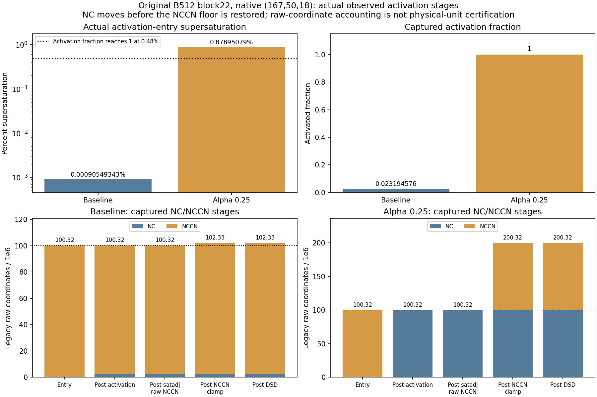

# Activation trace and requested-proposal-direction checks at fixed analysis time

This experiment uses one 20 s microphysics evaluation to diagnose tendencies
and their sensitivities. It is not a forecast cycle. It preserves the original
B512 block22, the accepted T/Q proposal as a real vector, the original native
geometry and the selected `norm_actual + actual_departure QR` research map.
No operational physics, ABI, observation mask, optimizer or host integration
was changed.

The AD/FD campaign below uses the **original continuous requested proposal**
(parent alpha.25 delta / .25). It does not use the post-binary32 effective
native displacement introduced by PR #451. No calls for that new C4 effective
direction were made in this campaign; its separate check is pending. The
8,619 signed-zero differences per component describe two encodings of the
original requested vector, not the later quantization change.

The activation mechanism is now located by actual internal measurements.
The candidate-direction raw/finish and BT/cost tests agree at epsilon=1e-6.
**The stronger predeclared joint 33-category criterion does not pass:** weak
profile coordinates fail their coordinatewise FD envelope at every tested
step. All failures remain in the data. This does not establish cloud-analysis
efficacy or a complete Jacobian certificate.

## Native context and actual values

The target is flat11632, block22 row368, native 1-based `(i=167,j=50,k=18)`.
The observer also records native levels 5,17,19 as context. Every physics call
retains all 512 original columns and 39 levels. Only the observation profile is
selected to N=1 after full-B physics. Fresh target-only baseline K and alpha.25
direct results match the corresponding historical full-batch target bitwise
for seven BTs and nine profile fields at both points; the baseline also matches
all eight live K fields.

| Actual activation-entry / update | Baseline | Alpha .25 |
| --- | ---: | ---: |
| T at activation entry, K | 267.8968586681 | 267.8458221684 |
| QV at activation entry, kg/kg dry | .00528965750226753 | .00531610578891578 |
| water saturation mixing ratio qs1, kg/kg dry | .00528960960520027 | .00526978695460943 |
| supersaturation, **percent** | .000905493426528 | .878950794506639 |
| activated fraction | .0231945760394 | 1 |
| NC before activation, raw coordinate | 323293.719499 | 323293.719442 |
| NCCN before activation, raw coordinate | 100000000 | 100000000 |
| actual ncact, raw coordinate/s | 100183.127260 | 5000000 |
| NC after activation | 2326956.264700 | 100323293.719442 |
| NCCN after activation | 97996337.454799 | 0 |
| NCCN after final reservoir clamp | 100000000 | 100000000 |
| complete cloud evaporation | false | false |
| NC after final DSD | 2326956.264700 | 100323293.719442 |

The source computes

```
s = 100 * (qv / max(qs1, QCRMIN) - 1)
f = min(1, safe_pow(max(s/.48, 0), ACTK))
raw = max((NCCN + NC)*f - NC, 0) / dt
capped = min(raw, max(NCCN,0)/dt)
ncact = capped if s > 0 else 0
```

Here `dt=20 s`. Alpha .25 reaches the fraction's saturated branch. The raw
rate equals the reservoir limit exactly: `reservoir_tie=true`, not an extra
strict `raw>limit` reduction. The 1e8 transfer is applied at activation.
Subsequent partial saturation adjustment, threshold cleanup and final DSD do
not change target NC. **The later NCCN floor explains the unchanged endpoint
reservoir; it is not the direct cause of this same-call NC increase.**

The clamp adds 2,003,662.5452 / 100,000,000.0 to the baseline / alpha.25 raw
NC+NCCN coordinate ledger. At the baseline, the sum of the separately rounded
NC/NCCN changes is -1.862645149e-9 even though the difference of endpoint sums
rounds to zero. Neither is an absolute physical-number conservation certificate:
historical number units remain conditional. QV/QC paired-update residuals
are approximately 1e-19 kg/kg. Source-order algebra from captured rates
reproduces all selected state updates; qs1 and final satadj pcond themselves
are captured operands, not independently rerun thermodynamic solvers.



The fraction in this figure is the activation fraction, not RTTOV CFRAC.
The restored NCCN pool is a later state-coordinate source. No new floor or
compensation policy is introduced. Two measured input amplitudes do not locate
a threshold in alpha or prove a discontinuity.

## Instrumentation and first-order noninterference

The generated coordinator only inserts observations. Scalar extraction and
serialization are explicit value-only operations; no extracted value returns
to physics. The actual scheduler operands are saved for all B512 columns.
Each recorded microphysics invocation is paired with its schedule ordinal and
dt. Here every main and ice mstep is 1 at both basepoints.

The isolated build replaces only `coordinator.cpp.o` in the frozen actual-QR
archive; the other 13 object members, including actual-QR sedimentation, are
unchanged. `-ffp-contract=off` and the 14 exported C ABI symbols are retained.
The operational install is not modified. This is a separately attributed local
native build, not an assertion that path-skipped Port CI rebuilt the observer.

Fresh processes compare original-control, observer-off and observer-on at
baseline and alpha .25. Full saved primal fields match the parent results.
All **98 saved AD arrays** (raw ABI inputs/outputs/directions/JVP/VJP, native
outputs/tangents, gradients and seeds) match bitwise across modes.

| Selected transpose check | Relative error |
| --- | ---: |
| baseline native finished-theta functional | 2.93e-16 |
| alpha .25 native finished-theta functional | 1.58e-15 |
| baseline raw ABI functional | 2.93e-16 |
| alpha .25 raw ABI functional | 2.88e-16 |

A separate baseline target-Huber cotangent from the actual saved RTTOV K is
also propagated through the **connected** profile and full-B native map.
Its directional numerator is -27871.523796247795; the full-B gradient dot is
-27871.52379624777 (relative error 9.14e-16). The raw ABI dot error is
7.83e-16. Its cotangent reaches target NC, so this stresses the number path.
This is first-order K/cotangent injection at the baseline, not differentiating
RTTOV K or treating a linear proxy value as a new nonlinear cost.

## Requested proposal direction and independent FD

This direction is the original T/Q proposal, not the historical sinusoidal
probe. Its target perturbation at unit alpha is -0.1403974893 K moist theta
and +0.1057931501 g/kg dry QV. The saved AD direction's zero encoding comes
from the parent alpha.25 delta divided by .25. It is numerically identical
to the accepted public proposal, with signed-zero differences retained in
[direction lineage](direction_lineage.json). All ten finite native inputs are
bitwise identical under both recipes. No nonzero increment, normalization or
frozen block is altered.

The baseline profile-JVP density component omitted by the first AD serializer
is explicitly reconstructed with the pinned post-finish prep JVP, with
matching primal density. The separate cost-VJP run captures that density
tangent directly and matches the replay bitwise. It is not silently labeled
as an originally captured field.

Five centered FD steps are frozen before endpoint evaluation: 1e-2, 1e-3,
1e-4, 1e-5, 1e-6. Every signed endpoint rebuilds the input from the original
background once, executes full-B KDM, constructs a live profile and runs a new
actual direct RTTOV call. Observation mask, weights, all 66 CFRAC values and
quality remain unchanged at every endpoint. All recorded schedules remain 1.

The new actual-candidate IR105 JVP is **-4638.5285095713 K per unit alpha**.
The target Huber seed is +1 in all seven channels (weights=1). The target
Huber numerator JVP is -27871.523796247795. These infinitesimal values are
not finite BT or cost changes. Historical +3368.277 probe data is not used.

| Epsilon | Target raw12+finish5 maximum ratio | Profile coordinate maximum ratio | Native17 pass | Profile8 pass | BT7+cost pass |
| --- | ---: | ---: | --- | --- | --- |
| 1e-2 | 26895 | 30259 | no | no | no |
| 1e-3 | 15767 | 7456 | no | no | no |
| 1e-4 | 489 | 2278 | no | no | no |
| 1e-5 | 4.65 | 39.31 | no | no | no |
| 1e-6 | .191 | 215.56 | yes | no | yes |

Ratio <=1 is the unchanged passing rule. Native17 uses the inherited scaled
field-max envelope; profile8 uses its separately predeclared **coordinatewise**
envelope 1e-8+3e-5*max(abs(FD),abs(JVP)). They are different norms. At 1e-6,
the main liquid-diameter coordinate agrees (ratio .219), while weak Q, P,
P_HALF and T coordinates dominate failures. For example native-profile Q at
RT layer65 has JVP .0001315792 versus FD .0001346052 ppmv/alpha. The small
endpoint differences and growing error as epsilon shrinks are consistent with
resolution/cancellation limits, but do not prove every weak derivative correct.
The failed coordinate criterion is not replaced by a looser max norm.

Therefore no epsilon passes all 33 categories at once. The arithmetic replay
can pass while this scientific criterion remains false. Full-B diagnostics,
all per-field failures, exact-tie predicates and branch changes are retained.
Agreement for one direction does not certify every internal branch, higher
order derivative or parameter identifiability.

## Execution accounting and reproducibility

New calls in this localized campaign:

| Stage | KDM forward | KDM JVP | KDM VJP | RTTOV K | RTTOV direct |
| --- | ---: | ---: | ---: | ---: | ---: |
| value control/off/on, two basepoints | 6 | 0 | 0 | 0 | 0 |
| AD control/off/on, two basepoints | 6 | 6 | 6 | 0 | 0 |
| completed FD endpoints | 10 | 0 | 0 | 0 | 10 |
| one unserialized FD attempt | 1 | 0 | 0 | 0 | 0 |
| target cost VJP | 1 | 1 | 1 | 0 | 0 |
| observation pilot | 0 | 0 | 0 | 1 | 1 |
| **Total** | **24** | **7** | **7** | **1** | **11** |

Host and optimizer calls are zero. The first FD forward completed but failed
in NumPy/Tensor postprocessing before saving an endpoint. It is counted and
its full trace matches the corrected first endpoint's trace byte-for-byte.
A zero-profile observation preflight made zero calls; one fresh baseline K
completed before an extra fixed-O3 comparison failed. Its raw output was parsed
without another K call. Failed attempts and their source-availability limits
are retained separately; they are not silently counted as successful tests.

Replay the published arithmetic without native/RTTOV executables:

```sh
python -m harness.analyze_activation_trace \
  --trace harness/evidence/block22_activation_2026-10-25/data/activation_trace.tsv \
  --receipt harness/evidence/block22_activation_2026-10-25/data/source_receipt.json \
  --base-call 1 --probe-call 2 --output NEW_trace.json
python -m harness.replay_activation_fd \
  --manifest harness/evidence/block22_activation_2026-10-25/input_manifest.json \
  --output NEW_FD.json
```

Run from the repository root. Outputs must be new. PH/MU are source-bound common inputs, not separately
captured per endpoint; raw held-rest rows and effective PH+PHB geometry are
verified from the captured arrays. Native prep pressure/PII remain live.
The packet's file paths, sizes, SHA-256 values, source receipts and execution
counts are inventoried in [publication_manifest.json](publication_manifest.json).
The exact replay inputs and outputs are pinned: `input_manifest.json` SHA-256
`1aad1ef9ce41faba56cfff6e23fc0bacf3e89c6422f505e65c80ffc269667a5d`,
`replay_result.json` SHA-256
`9ae770d76a10d83288157fb962cd927302ae592113b58f89fc163e27001bdaec`, and
`activation_analysis.json` SHA-256
`244a761f8608888cacc747f64f4741e3a4be5824920f8c7b076d6bf8a95319ce`.
The source receipt is SHA-256
`b1da1cade982227e21ab4ed6c97820a3aff9b914cdc454951e057477ec1bdd4c`; the
actual call ledger is SHA-256
`42ceed2ec9333ea21a4f2d6d4d6c9a40199e9d5353bbe8b3abb7a28c362adc1b`.

## Cloud-analysis judgment

This is a mechanism and selected-direction experiment. It does not improve the
accepted analysis or make the prior full-domain one-shot result an effective
cloud initialization. That result's cost acceptance is preserved as an
engineering fact. Weather efficacy must be judged by co-located actual T/QV,
QC/QI/QS and LWP/IWP response and O-B/O-A improvement in the relevant regions,
not by this one column, a maximum increment or a small global cost decrease.
The separate offline [native cloud efficacy audit](../native_cloud_efficacy_2026-10-25/README.md)
reports that the one-shot cloud-analysis effectiveness goal is not met; it
contains domain-scale saved-response diagnostics and retains its own scope and
limitations.
See [fixed-time tendency analysis](../../../docs/ONE_STEP_TENDENCY_ANALYSIS.md).
The original pixel-time/navigation, IR133 identity and unit/budget limitations
remain. No forecast clock advancement is required or claimed for this goal.
