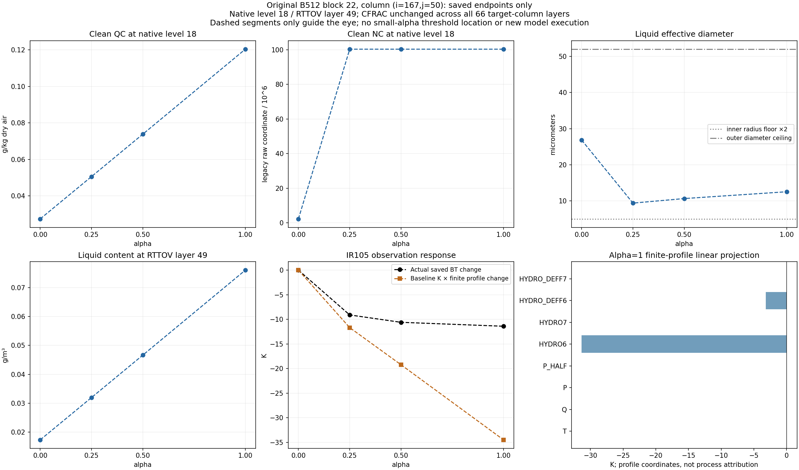

# Saved block 22: cloud moments, optics and a large finite BT response

This analysis preserves PR #448's completed increment/application and accepted
cost result. It explains additional **saved endpoint relationships**, with
zero new KDM, RTTOV, host or optimizer calls. It does not prove a named-process
cause, a discontinuity, or local derivative/forecast stability.

The complete original B512 block is retained in [saved_fields.npz](saved_fields.npz):
flat indices [11264,11776), 39 native levels, seven channels. Baseline and the
three original trials are receipt/hash-bound. The restricted alpha=1 block
matches the old unrestricted alpha=1 block bitwise. Selecting a row for
analysis does not change the original execution to B1.

Target: flat index **11632**, local row **368**, native 1-based
**(i=167,j=50,k=18)**. Native bottom-first level 18 maps to top-first RTTOV
layer **49** of 66. The other active liquid layer is native level 5 / RTTOV 62.
All seven target channels are on baseline support.

## Measured endpoints

| Alpha | QC after, g/kg dry | NC after, legacy raw / 1e6 | Liquid content, g/m³ | Liquid Deff, μm | CFRAC | IR105 BT, K | BT−baseline, K |
| --- | ---: | ---: | ---: | ---: | ---: | ---: | ---: |
| 0 | 0.0273974244 | 2.326956265 | 0.0173120778 | 26.83008627 | 0.999999 | 277.29348362 | 0 |
| 0.25 | 0.0505709523 | 100.323293719 | 0.0319551300 | 9.38601693 | 0.999999 | 268.18578372 | −9.10769990 |
| 0.5 | 0.0737955436 | 100.323293719 | 0.0466304485 | 10.64611132 | 0.999999 | 266.68844006 | −10.60504356 |
| 1 | 0.1203703771 | 100.323293719 | 0.0760604828 | 12.53201290 | 0.999999 | 265.88836924 | −11.40511438 |

Density is bitwise unchanged at 0.6318870522265209 kg/m³ at this layer. QC is
4.39349 times baseline at alpha=1, while NC is already about **43.1135 times**
baseline at alpha=0.25 and nearly constant at the larger endpoints. These four
coarse points do not locate where the response changes or prove a jump.

Input QC/NC at the target are positive: 2.7373653210815974e-5 kg/kg dry and
323406.78125 in the legacy raw number coordinate. Restricted alpha=1 captures
NC=100323293.71926157 at the raw kernel return and the same value after outer
cleanup. QC raw/clean is likewise identical. Candidate raw QI=8.4366e-11 is
removed by the recorded outer threshold; that separate removal is not
identified as the cause of the liquid-cloud response.

The model-profile layer temperature increases from 267.89694 to 268.00108 K,
while the column IR105 BT decreases by 11.405 K. Physical temperature, native
moist-theta input, heating memory, and observed-channel BT are different
quantities. No physical-temperature-to-BT unit equivalence is assumed.

## What the optical mapping establishes

The bridge maps QC to HYDRO6 and maps raw NC through the recorded shared
density coordinate into the active cloud DSD. At the saved target endpoints,
the ratio relation is

```text
e = float32(1 / float32(3)), promoted to binary64
  = 0.3333333432674408

D(alpha) ≈ D(0) * exp(e * log(
    [rho(alpha)*QC(alpha) / (rho(0)*QC(0))] * [NC(0)/NC(alpha)]))
```

Using the execution coefficient gives Deff predictions 9.386016928046885,
10.646111315468122 and 12.532012900174156 μm. Their maximum difference from
the saved values at level 18 is **1.07e-14 μm**. Exact mathematical 1/3 instead
leaves about 2.84e-7–2.94e-7 μm. This is a baseline-anchored relative mapping,
not a new absolute-unit or number-budget certification.

CFRAC is bitwise identical across **all 66 target-column profile layers** in
all four frames. The source uses the detached content gate
`CLW+CIW > 1e-6 g/m³` to choose 0.999999 or zero. The target liquid Deff values
are above the inner effective floor 5.02 μm and below the outer 52 μm ceiling.
Thus the saved optical response is consistent with changed QC/NC moments;
it is not an endpoint CFRAC switch or final liquid-Deff clamp transition at
this layer. This does not reveal unrecorded internal microphysics branches.

## Finite-profile RTTOV linearization

For each saved finite profile difference, form

```text
L(alpha) = sum_variable,layer K_baseline(variable,layer) *
                          [profile_alpha − profile_baseline]
E(alpha) = [BT_alpha − BT_baseline] − L(alpha)
```

Products round to binary64 before `math.fsum`. Center P and P_HALF retain
their different lengths/units. All 66 layers (67 interfaces) and eight K
fields enter the sum, including the live upper partial layer.

| Alpha | Actual IR105 ΔBT, K | Baseline K × finite Δprofile, K | Actual−linearization, K |
| --- | ---: | ---: | ---: |
| 0.25 | −9.107699902 | −11.684564521 | +2.576864619 |
| 0.5 | −10.605043563 | −19.227216040 | +8.622172477 |
| 1 | −11.405114381 | −34.495792357 | +23.090677976 |

The alpha=1 projection terms are T +0.025475270 K, Q −0.001010016 K,
P −0.003654108 K, P_HALF +0.005518560 K, HYDRO6 −31.342810860 K,
HYDRO_DEFF6 −3.179311165 K, HYDRO7 about −3.75e-8 K and HYDRO_DEFF7 zero.

Liquid coordinates dominate **this linear projection**. They are not actual
additive causal contributions to the nonlinear finite BT response. The large
remainder quantifies the limited accuracy of extrapolating baseline K over
these profile changes; it does not by itself establish an erroneous K.
Nor is this contraction the JVP of the native input descent direction.

## The separate saved probe

The original baseline also saved a sinusoidal native-input probe. At level
18 its theta/QV direction is +0.1429640902 K / −6.15791715e-5 kg/kg dry,
opposite in sign to the candidate's local −0.1403974893 K /
+1.0579315014e-4 kg/kg dry. Its IR105 JVP is **3368.277002079154 K per unit
probe parameter**, reconstructed bitwise from the saved K/profile JVP.
Its liquid content/diameter terms are +22.946025185 / +3345.308131689 K;
the other terms sum to the recorded total.

This large infinitesimal directional value is not a physical finite BT or an
alpha-scalable candidate prediction. Block 22 was not among the original four
independent sparse-FD pilot blocks. Transpose consistency and this contraction
do not newly certify local FD accuracy at the target.

## Scope over the block and state/rate consistency

Block 22 has **291 baseline-supported IR105 columns**. At alpha=1 its p95
absolute BT response is 0.275123 K, three columns exceed 1 K and one exceeds
5 K; the target is the block maximum. These block statistics are different
from the previously reported whole-domain p95=0.01982 K.

For all 512×39 saved state values in the block, candidate-minus-baseline
relations retain the old-state term:

```text
ΔQV_out − ΔQV_input − 20*ΔQV_RATE
ΔQC_out             − 20*ΔQC_RATE
ΔTHM_out − ΔTHM_input − 20*ΔH_RATE
```

At alpha=1 their maximum residuals are 8.47e-22 kg/kg, 1.36e-20 kg/kg and
1.35e-13 K respectively. These are differences of stored states, not the
saved proposed input delta; subtracting rounded states has its own rounding.
The analysis does not change increments or reapply tendency.



Dashed segments only guide the eye. They are not additional evaluated points
or a smooth fitted response between zero and alpha=0.25.

## Code judgment and remaining confirmation

The increment calculation and accepted PR448 result stay closed. No NC floor,
mask reduction, normalization change, optimizer or physics/ABI modification is
introduced. A small NumPy analyzer checks saved hashes, full-B indexing,
profile-row mapping, seven-channel/interface contractions, restricted-alpha1
identity and state/rate relations.

The receipt-pinned C++ coordinator, not current public-main bytes alone, is
the engine authority. Its CCN activation has
`sw_percent=100*(qv/qs1−1)`, a positive-supersaturation gate, activation
fraction saturating at 0.48%, and number/reservoir limits. NCCN input and
output are 1e8 at the lower bound. This is a plausible nonlinear path, but
saved output NC does not uniquely determine the intermediate activation rate.
See [source audit](SOURCE_AUDIT.md).

To identify a named cause requires the post-state-update/reclassification
entry to activation: T, qv, qs1, sw_percent, activated fraction, ncact before
and after caps, and NC/NCCN before and after activation/saturation adjustment.
The current files lack those intermediates. Any such run must preserve the
original B512 and executed variant and separately show instrumentation
noninterference. A later small-step directional check would also need the
same direction and branch/schedule diagnostics. **Neither experiment was
performed here.** Four saved endpoints alone cannot distinguish a steep
smooth response from an intervening kink or locate its alpha.

The 40-second nominal-slot/model offset, unverified pixel UTC/navigation,
IR133 identity, legacy number-unit qualifications and absent closed physical
budgets remain unchanged. There is no new host/RK or forecast-skill claim.

## Reproduce without private executables

```sh
python -m harness.analyze_saved_block_response \
  --manifest harness/evidence/native_block22_response_2026-10-25/input_manifest.json \
  --output-json /new/path/analysis.json --plot-dir /new/path/figures
```

Both outputs must be new. The [manifest](input_manifest.json),
[extraction/source inventory](source_inventory.json) and [analysis](analysis.json)
distinguish original execution, immutable subset extraction, this public
arithmetic, and source-based hypotheses. No new models were run.

`history/analysis_initial.json` preserves an intermediate arithmetic output
made before the separate saved probe was added to the published subset. Its
input/analyzer hashes refer to that earlier draft; it is not the current
replay target. The authoritative replay target is `analysis.json` with the
current `input_manifest.json` and `saved_fields.npz`.
