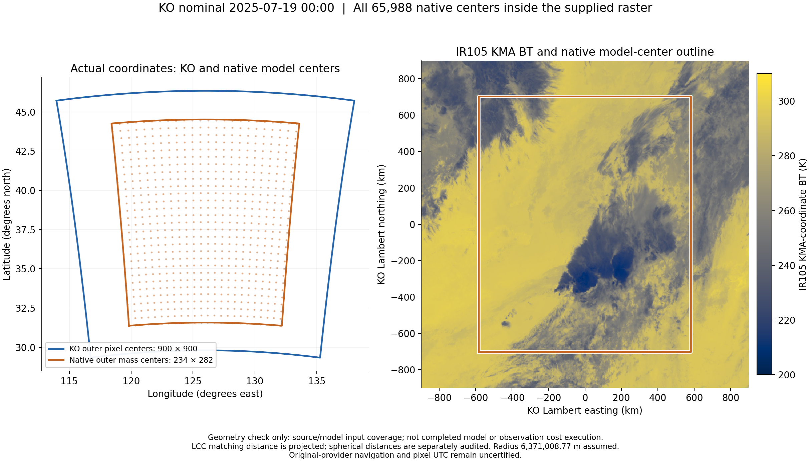
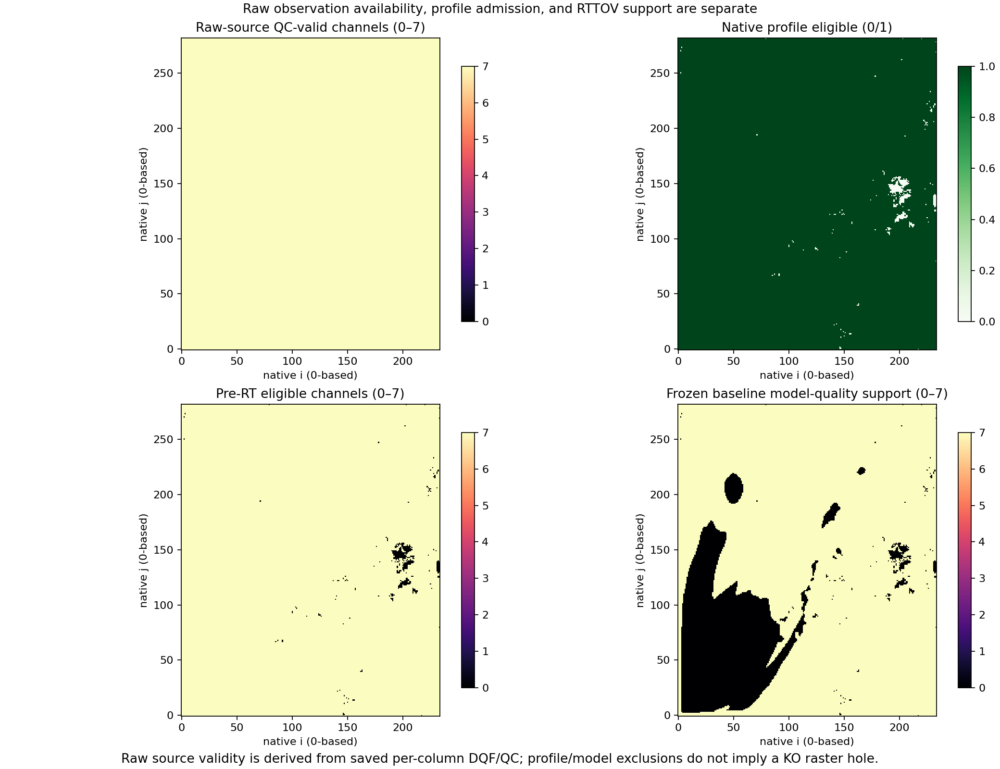
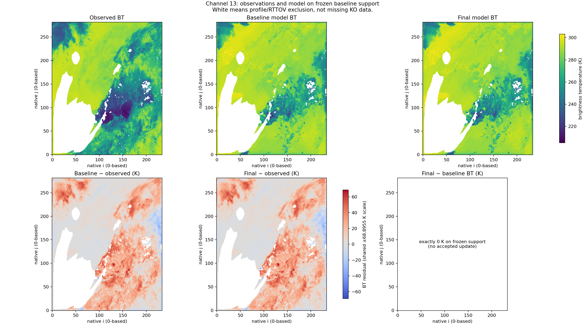

# Full-domain KO7 bounded T/Q case: no acceptable update

The fixed case completed observation linkage, the global cost and gradient,
independent derivative checks, and all three bounded T/Q proposals over the
entire native model domain. **None of the proposals preserved the baseline
observation support.** The recorded result is
`COMPLETED_NO_ACCEPTABLE_UPDATE`; the accepted input state and final BT remain
the baseline. This is completion of the prescribed experiment, not convergence,
an accepted assimilation cycle, or improved forecast skill.

The numerical run finished on 2026-10-24 UTC (2026-10-25 in UTC+09). Its identity
is `b2779685e0f5ef6c8d6627e4d74a4904d2dbea06bb3052b4c0586c28dbb27fc7`.
The machine-readable products are in the unchanged, hash-pinned
[publication bundle](data/publication_manifest.json).

## Case and executed map

| Item | Recorded contract |
| --- | --- |
| Observation | Provided KO nominal `202507190000` scene; AMI channels 10–16 |
| Native input | Saved MP137 `2025-07-19_00:00:40` state |
| Horizontal / vertical grid | 234 × 282 = 65,988 columns; 39 mass levels / 40 interfaces |
| Physical partition | Original 128 × B512 plus B452, without padding or boundary trimming |
| Map | Native prep → `norm_actual` + actual-departure QR KDM → cleanup/finish → post-finish EOS → native pressure/cloud profile → actual RTTOV → KMA-coordinate BT |
| Direct controls | Native moist-theta perturbation and dry QV mixing ratio |
| Held inputs | MU/PH, other initial fields, surface/geography/viewing conditions and constants |
| Local physical interval | 20 seconds; no host timestep, RK integration or native cycle |

The prep and post-finish EOS remain live functions of the controlled state.
Holding MU/PH does not freeze every pressure/Exner dependency. The finish retains
its direct dependence on the old state; QV/QC rates include the old-state
subtraction. The fixed upper reference supplies 26 complete layers plus one
live partial layer above the native levels; trace gases remain fixed on the
recorded template layer indices.

The source authority is immutable `source_v3`, based on main `792e890e`, rather
than a claim that the later evidence commit executed the experiment. The
[source manifest](data/source_manifest.json) preserves the source/build/input
hashes and the resolution to `42681454`: 292 of 293 files are byte-identical;
the remaining Python file has the same AST and a documented EOF whitespace
difference. The candidate is the isolated research library SHA-256
`5ef3b287cfff0a65e268f79d7f13f17540b5b477fcf647b3859ba61919ac0c99`,
using PyTorch 2.13.0 on macOS arm64. It is distinct from the operational install
and the pinned CI environment. Preserved K replays are explicitly qualified
historical-output recovery, not a claim that historical dynamic-library bytes
were captured.

## Spatial coverage and observation support

All 16 provided raw channels were inventoried at their stored resolutions; only
the selected seven enter this objective. All 65,988 native centers lie inside
their provided KO footprint. Independent nearest-owner checks over the 810,000
selected-grid pixel centers reproduce all 65,988 unique owners, with 14 direct
exhaustive great-circle checks. No quality-dependent pixel replacement was used.

The recorded matching distance is an LCC-plane distance: maximum stored value
850.378662 m. The independent spherical diagnostic is 880.346163 m. The original
preparer's projected-distance formula and binary32 storage reproduce all stored
distance values exactly; neither metric changes the selected owners here.
The [geometry receipt](data/geometry_coverage.json) retains the assumed
6,371,008.77 m radius and source hashes. Coordinate overlap does not authenticate
the original provider navigation or establish pixel UTC.

| Baseline stage | Columns | Channel cells |
| --- | ---: | ---: |
| Raw KO source QC-valid | 65,988 | 461,916 |
| Native profile-valid before RTTOV | 65,540 | 458,780 |
| Fixed quality-zero cost support | 54,504 | 381,528 |
| Initial NC/NI-negative exclusion | 7 | 49 |
| Post-microphysics profile exclusion: positive QC without positive NC | 441 | 3,087 |
| RTTOV quality exclusion among profile-valid rows | 11,036 | 77,252 |

Every model column is retained in its full KDM batch and appears once in the
outputs or exclusion records. All seven initial NC/NI-negative columns lie on
outer model-center rows/columns and have frozen T/Q controls. The two negative
BG diagnostic rows are not particle-number exclusions: `(234,128)` and
`(46,282)` remain admitted in all seven channels. Coordinates here are 1-based;
the map axes explicitly use 0-based indices.





White/excluded cells in the comparison figures refer to frozen model/profile
support. They do not represent holes in the supplied KO raster.

## Global objective and gradient

For `x=x_b+S z`, use `S_theta=0.2 K`, `S_q=0.02*QV_b`, unit observation sigma
(1 K), zero bias, Huber delta 1, and lambda 1. The scales are exploratory search
scales, not certified background-error standard deviations. The fixed objective
is

```text
Z = sum(m0 * w)
J = [sum(m0 * w * Huber_1(BT_KMA - observation)) + sum(z_active**2)/2] / Z
```

Each original block uses binary64 products and `math.fsum`; block numerators
are summed and divided once by global Z. No block mean is added to another
block mean. All owners are unique in this case, so supported weights are 1.

| Quantity | Result |
| --- | ---: |
| Global Z | 381,528 |
| Observation numerator | 4,255,356.85888542 |
| Baseline observation / total J | 11.153458878209252 |
| Baseline prior J | 0 |
| Active theta / QV degrees | 2,125,656 each |
| Maximum absolute scaled baseline gradient | 0.04893691881537146 |
| Global JVP/VJP dot relative error | 2.0207926076829038e-16 |
| Maximum block dot relative error | 7.666242670106173e-15 |

The gradient is nonzero. This outcome is not a stationary-gradient stopping
claim. Baseline QV has no exact-zero elements, so the zero-QV freeze rule was
not exercised by this actual case; unsupported controls were frozen.

Independent sparse central differences retain full original blocks 0, 34, 40
and 128. The other blocks cancel, and the symmetric prior is included. The 16
saved endpoint forwards were evaluated with actual RTTOV direct calls.

| Epsilon | AD | FD | Fixed tolerance ratio |
| --- | ---: | ---: | ---: |
| 1e-6 | 0.0009435454354656547 | 0.0009435503590999929 | 0.12853257158853928 |
| 3e-7 | 0.0009435454354656547 | 0.0009435546181946524 | 0.2397163871914252 |

The criterion is `error <= 1e-8 + 3e-5*max(abs(FD),abs(AD))`; ratios at most 1
pass. This validates the declared sparse direction, alongside every block's
transpose-consistency check. It does not certify every Jacobian direction or
internal branch. Earlier larger-step FD failures and observed branch changes
remain in [history](data/history.json); no tolerance was relaxed.

## Three actual bounded proposals

Form `d=-g_z/max(abs(g_z))` once from the baseline and evaluate `z=alpha*d`
from the same baseline for alpha 1, 0.5 and 0.25. All three proposals retain
the original 129 physical partitions and the same observations, weights and Z.

| Alpha | Evaluated columns / blocks | Max absolute native theta increment, K | Max relative QV increment | Lost supported profiles / channel cells | Result |
| --- | --- | ---: | ---: | --- | --- |
| 1 | 65,988 / 129 | 0.1403974893 | 2% | 29 / 203, across 25 blocks | Rejected |
| 0.5 | 65,988 / 129 | 0.0701987446 | 1% | 18 / 126, across 18 blocks | Rejected |
| 0.25 | 65,988 / 129 | 0.0350993723 | 0.5% | 13 / 91, across 13 blocks | Rejected |

Every lost profile has the recorded reason
`post_microphysics_profile_invalid:active QC requires positive native NC`.
These are failed profile-admission conditions, not failed execution receipts.
No NC floor, state repair, support shrink or additional alpha was introduced.
The three trial objectives remain null/invalid; a partial finite subset is not
used to claim a lower global cost. No newly quality-valid entries outside m0
were added to the objective.

The result is **no acceptable update within the fixed three-trial budget**.
Accepted input-control increments and accepted z are exactly zero; final BT,
quality and J equal baseline. Physical KDM before/after changes and tendencies
are separate, nonzero quantities. These are not the zero control-increment
maps. All reported gradients belong to the baseline; trial gradients were not
recomputed.

## Baseline / unchanged final channel statistics

Each channel uses the same 54,504 supported rows. Bias is model minus observed
BT; all entries below are K except the unit-sigma Huber mean. Full precision,
medians and p95 values remain in [summary.json](data/summary.json).

| Channel | Observed mean | Model mean | Bias | MAE | RMSE | Absolute residual p95 | Huber mean |
| --- | ---: | ---: | ---: | ---: | ---: | ---: | ---: |
| 10 WV073 | 249.053 | 252.488 | 3.435 | 5.465 | 8.306 | 19.250 | 4.993 |
| 11 IR087 | 269.810 | 282.031 | 12.221 | 13.655 | 19.083 | 40.051 | 13.176 |
| 12 IR096 | 251.304 | 262.649 | 11.345 | 11.737 | 14.267 | 27.606 | 11.239 |
| 13 IR105 | 271.416 | 283.964 | 12.548 | 14.194 | 19.936 | 41.802 | 13.713 |
| 14 IR112 | 270.329 | 282.346 | 12.017 | 13.883 | 19.665 | 41.396 | 13.406 |
| 15 IR123 | 267.775 | 278.713 | 10.938 | 12.859 | 18.427 | 39.011 | 12.393 |
| 16 IR133 | 257.366 | 265.636 | 8.270 | 9.594 | 13.989 | 29.969 | 9.154 |



The nonzero warm biases remain. This case demonstrates execution, derivative
and feasibility handling, with no observed-fit improvement.

## Applied-state replay, scope and call accounting

The independent final objective audit verifies every source pin, receipt,
index, fixed mask/weight, native/control gradient, trial vector hash, prior,
rejection and all 16 FD endpoints. The independent applied-state audit makes
129 additional value-only C++ calls with the same pinned candidate and runtime
selectors. All saved finish, native-profile, density and cleaned-cloud outputs
match bitwise across all baseline columns. Maximum H_RATE/QV_RATE/QC_RATE
relation residuals are each exactly 0.

The [applied-physics ledger](data/applied_physics_audit.json) separates raw KDM,
outer cleanup and applied changes and records moment diagnostics. DEN×DELZ
uses the actual replay's binary64 forcing. Any across-column sums of kg/m²
diagnostics are unweighted sums, not area-integrated regional mass. This replay
did not capture precipitation; water, energy and number closure are not
certified. Exact applied-output matching qualifies the replay; it is not a new
whole-host or higher-derivative proof.

| Recorded stage | KDM forward | KDM JVP / VJP | Fresh RTTOV K | Preserved K replay | Fresh RTTOV direct |
| --- | ---: | --- | ---: | ---: | ---: |
| Baseline | 129 | 129 / 129 | 125 | 4 | 0 |
| Three full-domain proposals | 387 | 0 / 0 | 0 | 0 | 387 |
| Sparse FD endpoints | 16 | 0 / 0 | 0 | 0 | 16 |
| Applied-state diagnostic replay | 129 | 0 / 0 | 0 | 0 | 0 |
| Public arithmetic replay | 0 | 0 / 0 | 0 | 0 | 0 |

The main baseline/proposal budget is 516 forward calls; FD and diagnostic
replays are listed separately. Development failures and earlier pilot runs
remain separately attributed in history. Worker count was 3, each with one
thread; native host steps and native cycles are both 0.

The separate [resource audit](RESOURCE_AUDIT.json) reads all 516 original
baseline/proposal receipts and checks each SHA against the public execution
records. Its [producer](RESOURCE_AUDIT.py.txt) makes no model calls.

| Stage | Median task wall time, s | Maximum task wall time, s | Maximum recorded worker RSS, GiB | Maximum recorded child RSS, GiB |
| --- | ---: | ---: | ---: | ---: |
| Baseline | 341.95 | 589.38 | 2.33 | 2.05 |
| Alpha 1 | 64.45 | 70.07 | 0.56 | 0.43 |
| Alpha 0.5 | 64.66 | 71.37 | 0.55 | 0.43 |
| Alpha 0.25 | 64.15 | 72.58 | 0.53 | 0.43 |

Task times are not total stage wall times. RSS fields are cumulative worker
and child high-water readings, not simultaneous whole-system memory. Total
CPU time and concurrent process-tree peak memory were not recorded.

The fixed KO nominal slot and saved model time differ by 40 seconds. Pixel
UTC, original-provider navigation and IR133 spectral identity remain
conditional. Initial legacy/raw number units are not authenticated or
migrated; optical NC/NI divide raw outputs by the same live post-finish dry
density used in the cloud bridge. This does not establish host number budgets
or general parameter identifiability. Prior raw NCCN stress and whole-reference
pressure FD limitations remain separate historical limits.

## Public replay and completion evidence

From a public checkout with NumPy:

```sh
python -m harness.replay_native_satellite_case \
  harness/evidence/native_satellite_case_2026-10-25/data
```

The [recorded public replay](PUBLIC_ARITHMETIC_REPLAY.json) verifies file hashes,
all native indices, one global Z, exact baseline cost, published-gradient dot,
all three control hashes and losses, and the unchanged final input/BT. It makes
no KDM, RTTOV or host calls. Its dot uses already normalized published gradients
and has its own reported rounding path; it is not asserted bit-identical to
the private numerator-first dot. A public replay cannot independently execute
private kernels, inputs, RTTOV or authenticate provider navigation.

| Requirement | Evidence / result |
| --- | --- |
| P0 fixed input, channel, time and coverage identity | [Source manifest](data/source_manifest.json), [geometry](data/geometry_coverage.json), [input audits](data/input_audits.json) |
| P1 every column has an observation or explicit exclusion | Exact native indices, [support](data/observation_support.npz), [exact reasons](data/observation_reasons.jsonl.gz), [reason map](data/maps/native_reason_categories.png) |
| P2 full-B composition and original tail | All 129 baseline/proposal receipts and partition hashes in [execution receipts](data/execution_receipts.json); portable cross-column affine tests |
| P3 baseline/global gradient and independent sparse FD | [Execution receipts and audits](data/execution_receipts.json), [baseline gradients](data/baseline_native_gradient_cost.npz), [tangent](data/baseline_native_tangent.npz) |
| P4 fixed support and three bounded actual reevaluations | [Trial metadata](data/trials/trials.json), exact trial BT/quality/profile/reason arrays, all three rejected |
| P5 maps, statistics, increments and diagnostic interpretation | [Summary](data/summary.json), [native diagnostics](data/native_diagnostic_summaries.json), [maps](data/maps), applied-physics ledger |

Machine paths are redacted from provenance JSON. Exact execution-source
attachments retain original local-path examples so their producer hashes
remain checkable; these are helper strings, not private host source contents.
The hash-pinned data bundle is unchanged. This human report, public-replay
receipt and resource audit are separate curation documents tracked by Git.
