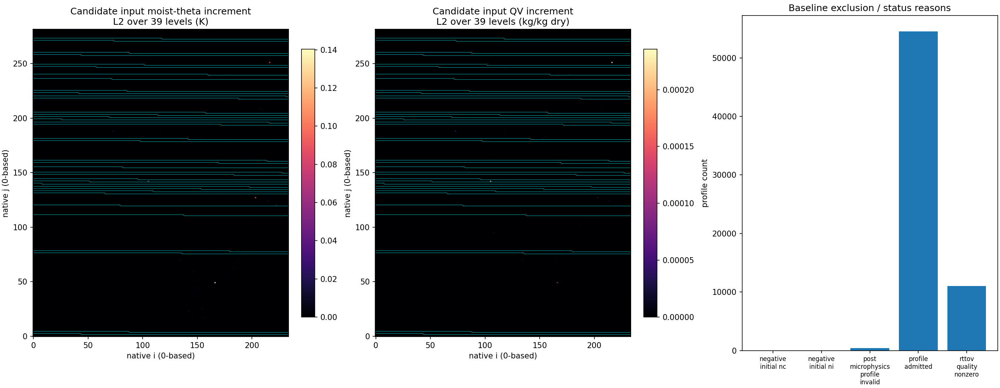
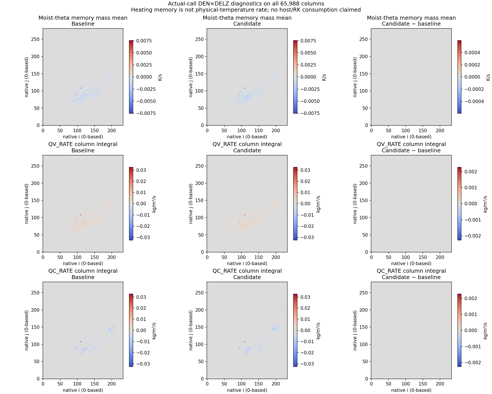
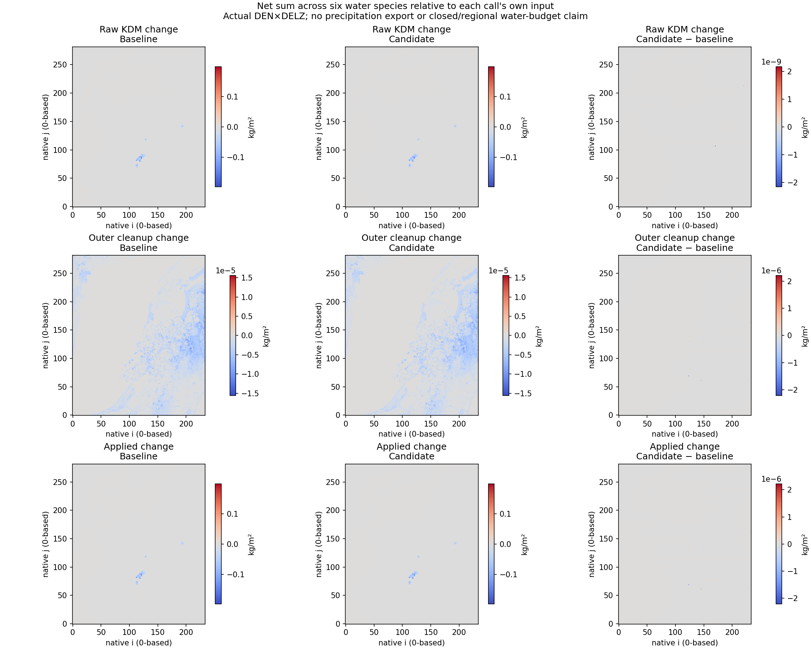
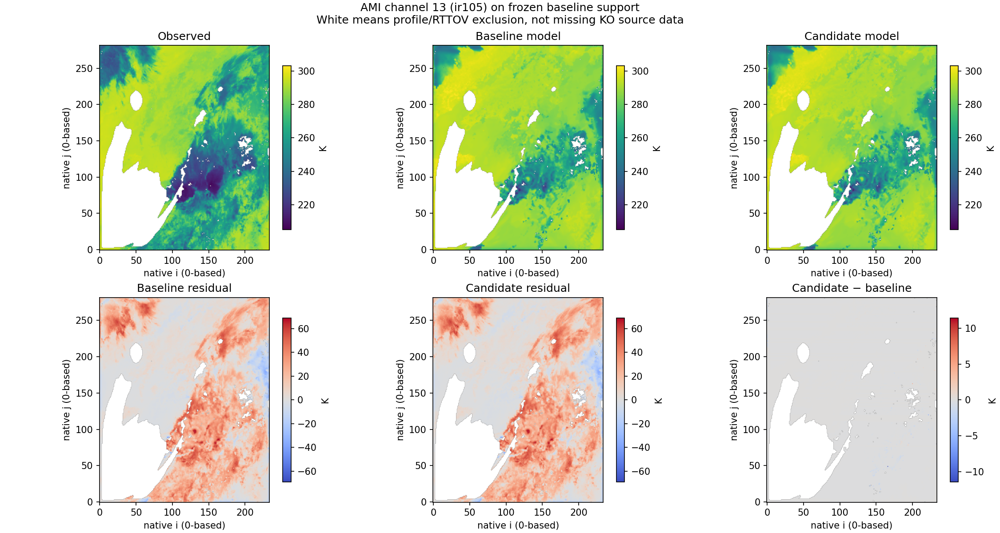

# Accepted restricted T/Q update on the complete native KO7 case

**One actual 129-block forward confirmed a support-preserving restricted
update.** The status is `RESTRICTED_UPDATE_ACCEPTED`. The same 381,528
baseline-supported channel cells give J=11.144979224162192, down from
11.153458878209252 by 0.008479654047059526 (0.0760271%). The saved-array
screening prediction and actual cost match exactly.

The parent PR #447 result remains `COMPLETED_NO_ACCEPTABLE_UPDATE`; none of
its three invalid proposals is relabeled. This is a new post-hoc subspace
experiment on the same scene, not convergence, independent validation,
forecast skill, or a host/RK cycle.
The [final completion record](FINAL.json) binds the finished state/rate
products, current publication and replay. The earlier runner confirmation's
`final_publication_pending=true` describes its forward-only stage and is
superseded by this separate completion record, not edited retrospectively.

## Case and selection

| Item | Fixed contract |
| --- | --- |
| Observation | Provided KO nominal 2025-07-19 00:00; AMI channels 10–16 |
| Native input | MP137 saved 00:00:40 state; local 20-second microphysics map |
| Domain | All 234×282 = 65,988 columns; 39 mass levels / 40 interfaces |
| Partition | Original 128×B512+B452, without padding or cropping |
| Operator | Native prep → norm_actual + actual-departure QR → cleanup/finish → live EOS/profile → actual RTTOV direct |
| Controls | Native moist-theta perturbation and dry QV mixing ratio only |
| Frozen controls | 25 whole original blocks, 12,800 native columns; all their observations retained |
| Remaining control subspace | 104 blocks; 1,679,418 possible theta and QV degrees each |
| Preserved objective support | 54,504 columns × seven channels = 381,528; unchanged observations/weights/Z |

The frozen blocks are the union of blocks containing the original three
proposals' lost profiles. The direction is the original `-Sg/max(abs(Sg))`
followed by whole-block zeroing, **without renormalization**. Selection uses
the same observations as evaluation and is explicitly post-hoc. Its batch
boundaries are not a smooth spatial analysis or a general feasible solver.

The selected [specification](restricted_candidate_sourcebound.json) binds z
SHA `1177f076e4d8421bfe855f3fd9e064d54bedcf353fcda211c35a4d7059710c38`.
The plan's full-array expression retains negative zeros in inactive entries;
the older bounded helper used positive zeros. Their 789,828 zero-sign
differences change hashes but not the reconstructed native input bytes. The
[screen audit](restricted_block_screen.json) preserves both recipes and the
signed-zero qualification.

## Actual result and execution

| Quantity | Measured result |
| --- | ---: |
| Baseline J | 11.153458878209252 |
| Actual observation numerator | 4,252,119.682871534 |
| Actual regularization numerator | 1.950564619163444 |
| Actual total numerator | 4,252,121.633436153 |
| Global Z | 381,528 |
| Actual J_obs | 11.144974111655065 |
| Actual J_reg | 0.000005112507127035091 |
| Actual J_total | 11.144979224162192 |
| Required cost decrease | 1.1115345887820926e-10 |
| Actual cost decrease | 0.008479654047059526 |
| Lost baseline-supported observations | 0 |
| Max absolute theta_m input increment | 0.14039748926644405 K |
| Max relative QV input increment | 2% of baseline QV, not relative humidity |

All 129 original blocks were actually calculated, including all 25 frozen
blocks and the B452 tail. The new calls are **129 KDM value forwards + 129
fresh RTTOV direct calls**, with zero new K/JVP/VJP, baseline-gradient, host
or extra-alpha calls. The process exited with code 0.

Run ID: `24e16697eec34ea28ff0ae51cf6be0144391f80af5ebc21f19223b06ed087139`.
The [confirmation](data/execution/CONFIRMATION.json) records the complete
receipts, fixed support, unchanged numerical threshold and exact comparison.
The [independent full audit](data/execution/FULL_RECONSTRUCTION_AUDIT.json)
compares all 129 saved physical/profile/finish/cloud/density outputs against
parent baseline for frozen blocks and old alpha=1 for the other blocks.
Those common stored arrays match byte-for-byte; BT/quality match on m0.
It does not compare unavailable old raw pre-cleanup kernel tensors or certify
every Jacobian direction.

Three workers used one thread each. The recorded orchestration interval is
22:26:53–23:20:54 UTC on 2026-10-24 (about 54 minutes). Median task wall time
is 67.97 s, maximum 107.03 s. Maximum recorded worker/child cumulative RSS
high-water readings are 655,704,064 / 465,649,664 bytes. These are not summed
concurrent system peaks or CPU time.

## State and tendency delivery

The bundle contains the actual candidate input, its increments and the
finish-applied receiving states. `t_new_after` is moist-theta perturbation
relative to t0, not physical temperature. RTTOV receives applied state and
live EOS/profile values; H/QV/QC rates are not added a second time.

| Product | Array coverage / check |
| --- | --- |
| [Input state](data/candidate_input_state.npz) and [delta](data/candidate_input_delta.npz) | Native T/Q and frozen-block mask; unchanged non-T/Q fields checked in execution captures |
| [Candidate applied T/Q](data/candidate_applied_tq.npz), [QC](data/candidate_applied_qc.npz) | Actual receiving values, with baseline equivalents also supplied |
| [Rate crosswalk](data/tendencies/tendency_crosswalk.json) | Producer, coordinates, units, formula, old-state subtraction, receiver and source/receipt lineage |
| H_RATE, QV_RATE, QC_RATE NPZs | Baseline / candidate / delta, each 65,988×39 binary64 values |
| Candidate rate formula audit | Each 2,573,532 values; bitwise match; maximum residual 0 for all three fields |
| Baseline QV/QC audit | Each 2,573,532 values independently matched; maximum residual 0 |
| Baseline H audit | Existing pinned 129-call applied-state audit, zero recorded residual; missing old raw theta is not reconstructed |

H_RATE includes dry-theta clipping and the water cross-term and is
finish-defined moist-theta heating memory (K/s). QV/QC rates are cleaned
minus input dry mixing ratios divided by 20 s. Input control increments,
per-call physical changes and candidate-minus-baseline tendency responses
are different products.

| Rate | Numerically changed values | Maximum absolute candidate−baseline difference |
| --- | ---: | ---: |
| H_RATE | 417,745 | 0.01412184780610127 K/s |
| QV_RATE | 269,492 | 6.883232148228655e-6 kg/kg dry/s |
| QC_RATE | 89,188 | 6.883232148228601e-6 kg/kg dry/s |



Cyan contours mark the frozen original blocks. The histogram accurately shows
baseline admission/status; full candidate reasons and counts are in the
comparison arrays and summary. Baseline and candidate have the same reason
counts in this experiment.



H is a call-mass-weighted mean of heating memory; QV/QC are column integrals
using actual call DEN×DELZ. These are not host/RK-consumed temperature or
water increments. The full vertical rate arrays and profiles are supplied.



Raw KDM, outer cleanup and applied water changes are separated and measured
relative to each call's own input. The arrays retain all six species. Sums
over columns are unweighted kg/m² diagnostics, not regional mass. The call
does not export precipitation here; no water/energy/number closure is claimed.

## Satellite response and limits

The support stays fixed. All seven channel-mean bias, MAE and RMSE values
decrease modestly. The warm biases remain large.

| Channel | Baseline bias K | Candidate bias K | Baseline RMSE K | Candidate RMSE K |
| --- | ---: | ---: | ---: | ---: |
| WV073 | 3.435329 | 3.434690 | 8.306213 | 8.305631 |
| IR087 | 12.221144 | 12.212176 | 19.082547 | 19.071372 |
| IR096 | 11.345311 | 11.339710 | 14.266873 | 14.259804 |
| IR105 | 12.547693 | 12.539187 | 19.935657 | 19.924997 |
| IR112 | 12.017195 | 12.008181 | 19.664549 | 19.653873 |
| IR123 | 10.937896 | 10.929132 | 18.427047 | 18.417515 |
| IR133 | 8.269670 | 8.264336 | 13.989877 | 13.984266 |



Observed/baseline/candidate BT share a scale, and residuals share a scale.
White marks model/profile exclusions, not missing KO source data. A small
domain-mean change does not imply small local changes: IR105's maximum
absolute BT response is 11.4051 K, while its p95 absolute response is only
0.01982 K. No named-process attribution is inferred from this map alone.

The saved [29-layer original-trial crosswalk](data/original_trial_fail29_crosswalk.json)
shows initial QC>0/NC=0, positive baseline output NC, and zero old-alpha=1
output NC at all 29 lost-support levels. Their QC is normal-sized and no
positive-NC optical division underflow occurs. Raw QC/NC are inferred via
the cleanup identity/pass-through at those positive-QC points, not newly
instrumented inside an individual process. No NC floor or moment repair was
introduced.

Pixel UTC and original-provider navigation remain unverified; nominal scene
and saved model state differ by 40 s. IR133 spectral identity, legacy number
units, upper-reference/trace-gas/surface assumptions and existing raw-NCCN /
whole-reference-pressure derivative limits remain qualified. The local
20-second map is not an actual 00:01:00 host forecast.

## Provenance and public replay

The physics authority is the parent-exact source_v3 tree and isolated research
DSO, with only the runner/objective overlaid in immutable source_v2.
The [source snapshot](data/execution/SOURCE_SNAPSHOT_v2.json) and executed
source attachments distinguish that from the current public commit. A later
public exception-output guard correction adds invocation-ID ownership only;
it changes no successful physical calculation. Curation_source_v2 is a
separate saved-array producer. Its original overlapping-label figure is
preserved; the replacement changes layout only, with unchanged numeric NPZs.
The public consumer's `initial_qc_kgkg` schema correction is likewise separate
from both physics execution and rate production.
Machine paths are abstracted in provenance JSON. Exact archived producer
source may retain original path literals so its source hash stays verifiable.

```sh
python -m harness.replay_native_satellite_case \
  harness/evidence/native_satellite_case_2026-10-25/data \
  --restricted-evidence harness/evidence/native_satellite_restricted_2026-10-25/data
```

The [recorded replay](PUBLIC_ARITHMETIC_REPLAY.json) verifies every published
artifact hash, indices, unchanged observations/support/weights/Z, signed-zero
controls, cost/prior/acceptance, actual receiving T_NEW and candidate H/QV/QC
formulas, baseline QV/QC formulas and rate deltas. It uses NumPy and makes
zero model calls. It cannot independently authenticate private inputs,
execute KDM/RTTOV or bit-compare hidden non-T/Q inputs.

All plan stages S0–S5 are evidenced: parent result preserved; restricted
candidate/source fixed; original 129-block actual pass; support/cost accepted;
full native state/rate delivery; maps, statistics and public arithmetic.
Public CI is a separate portable-code check and does not re-execute this
private research-library campaign.
